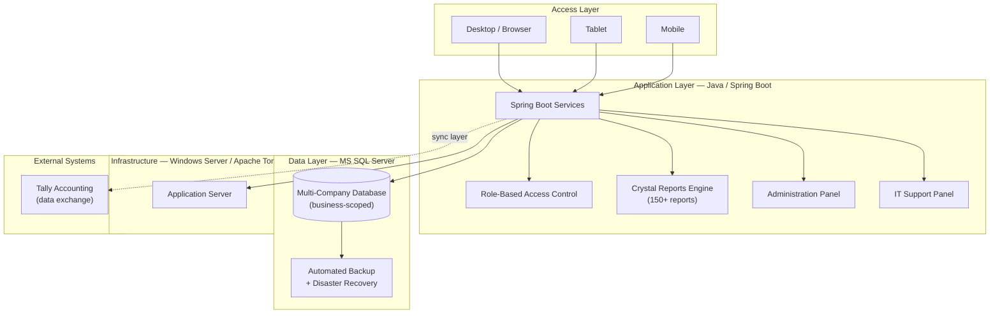
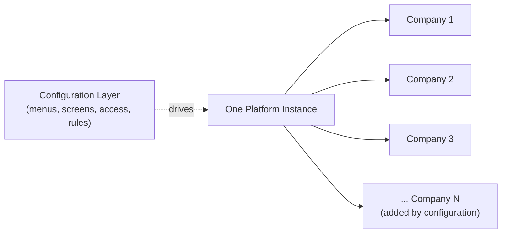
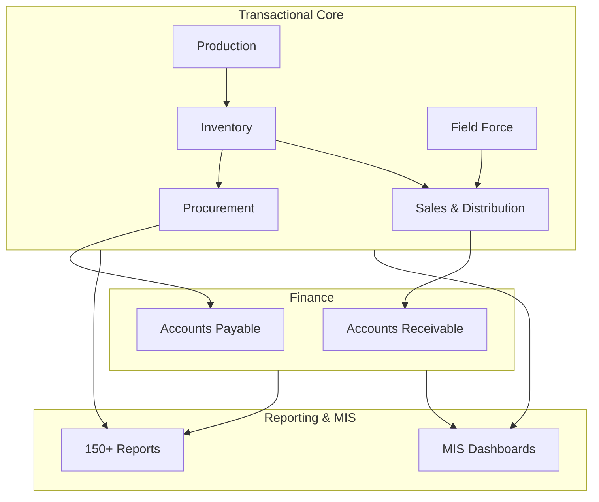

# Architecture at a Glance

A conceptual view of the platform — technology choices and structural patterns, without database schema, stored procedures, or screen-level specifications.

## System layers

## Multi-company model

*Adding a company is a configuration exercise, not a development project. 8 companies run on it today.*

## Functional module map

## Design choices that let it grow

- **Isolation by design** — every business unit's data is scoped, so one company's data never bleeds into another's
- **Config over code** — no per-company forks of the codebase
- **Split admin/support responsibility** — business admins manage their own users, codes, and parameters; IT support has a dedicated panel for platform-level troubleshooting
- **Backup/DR as a requirement** — the platform runs live manufacturing and distribution operations

---

*Database schema, stored procedures, and screen-level field specifications are intentionally excluded from this diagram.*
